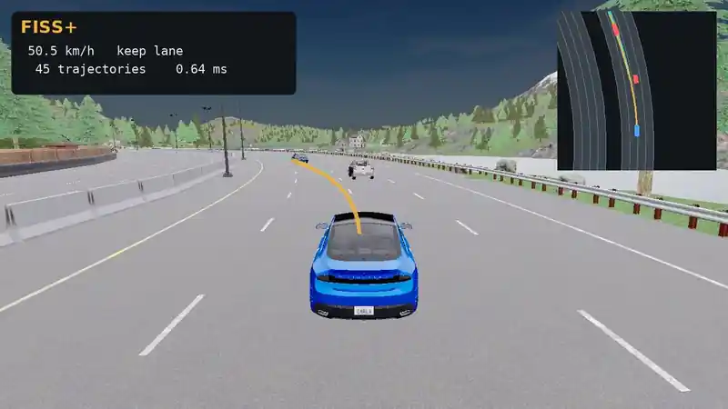
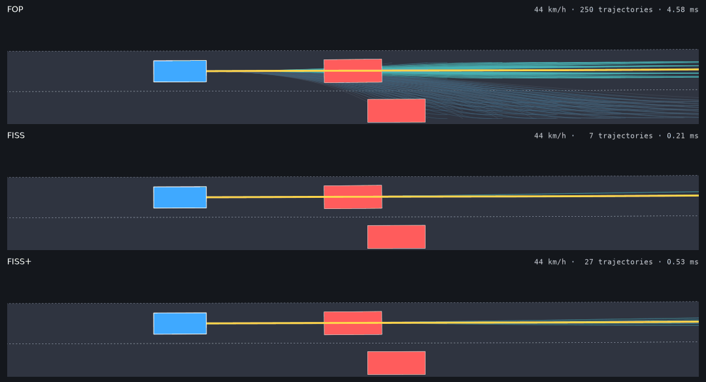
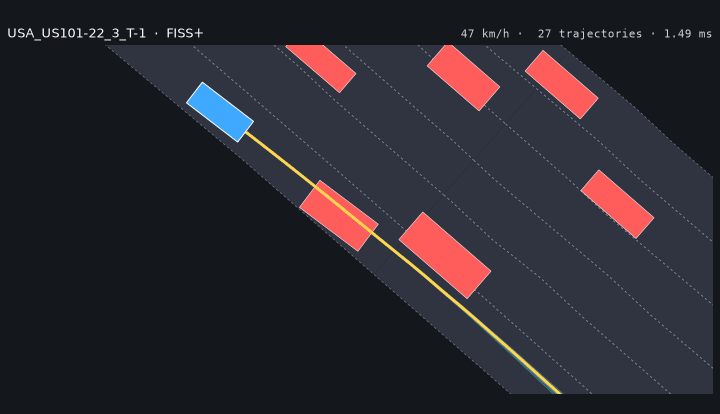
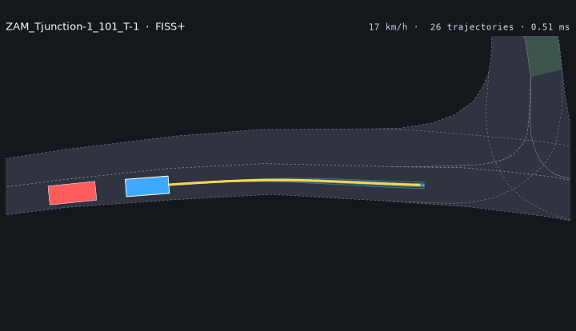
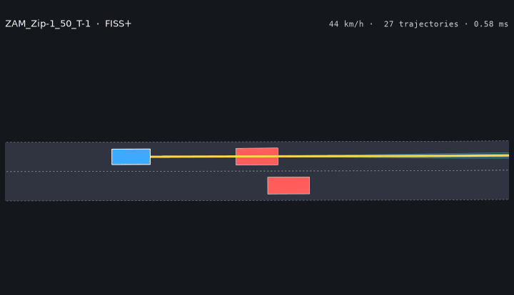
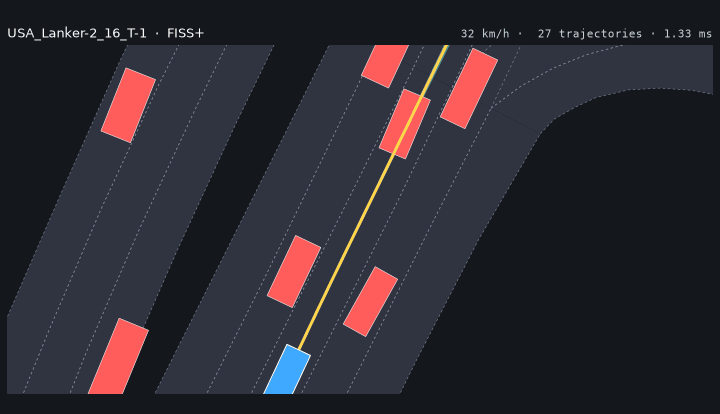
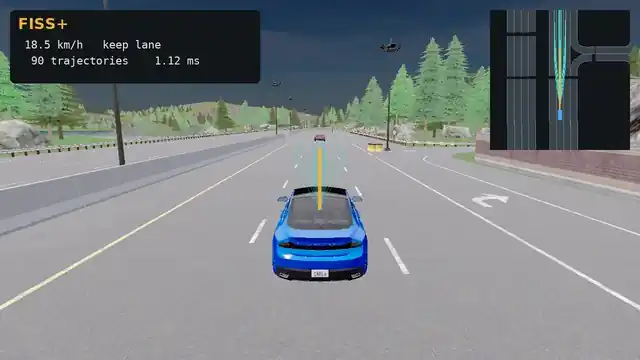
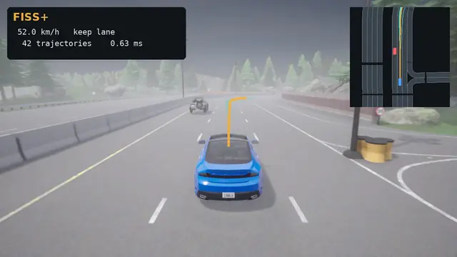
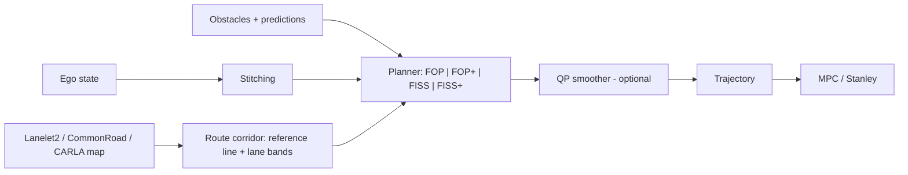

<p align="center">
  
</p>

<p align="center">
  <b>Fast Iterative Search and Sampling: map-aware trajectory planning for autonomous driving.</b><br/>
  FISS (RA-L 2022) · FISS+ (IROS 2023) and the FOP baselines in one C++17 core, with Python bindings, ROS 2 / ROS 1 nodes and an MPC controller.
</p>

<p align="center">
  <a href="https://github.com/SS47816/fiss_planner/actions/workflows/core.yml"></a>
  <a href="https://github.com/SS47816/fiss_planner/actions/workflows/python.yml"></a>
  <a href="https://github.com/SS47816/fiss_planner/actions/workflows/ros.yml"></a>
  <a href="https://pypi.org/project/fiss-planner/"></a>
  <br/>
  
  
  
  
  <a href="LICENSE"></a>
  <a href="https://doi.org/10.1109/LRA.2022.3191940"></a>
  <a href="https://doi.org/10.1109/IROS55552.2023.10341498"></a>
</p>

<p align="center">
  <br/>
  <sub>CARLA 0.9.16: FISS+ drives through 49 vehicles of mixed traffic, changing lanes to pass slower cars. Amber: executed plan · teal: candidate trajectories · inset: planner view.</sub>
</p>

<p align="center">
  <a href="https://ss47816.github.io/fiss_planner/demo/"><b>▶ Try the interactive replay in your browser</b></a> ·
  <a href="docs/foxglove.md">Inspect runs in Foxglove</a> ·
  <a href="https://ss47816.github.io/fiss_planner/">Documentation</a> ·
  <a href="examples/quickstart.ipynb">Notebook</a><br/><br/>
  <a href="https://colab.research.google.com/github/SS47816/fiss_planner/blob/main/examples/quickstart.ipynb"></a>
</p>

> **News — v1.0.0 (October 2026).** FISS, FISS+ and the FOP baselines are now one project, here: a C++17 core with `pip install fiss-planner`, ROS 2 / ROS 1 nodes and CARLA / CommonRoad / Lanelet2 support. It continues the former `frenet_planner` (`frenet_optimal_planner`) and `fiss_plus_planner` repositories. [Announcement](https://github.com/SS47816/fiss_planner/discussions/7) · [Release notes](https://github.com/SS47816/fiss_planner/releases/tag/v1.0.0)

## Why FISS Planner

- **Sub-millisecond planning.** FISS and FISS+ find near-optimal trajectories while generating 5–11× fewer candidates than exhaustive search. A full planning cycle takes **0.2–1 ms**.
- **Four planners, one interface.** Switch between `fop`, `fop_plus`, `fiss` and `fiss_plus` with one parameter, even while the vehicle is driving.
- **Map-aware.** Supports Lanelet2, CommonRoad and CARLA maps. The planner:
  - plans real lane changes using each neighbouring lane's own geometry;
  - only changes lanes where that's legal;
  - caps speed by the speed limit and road curvature;
  - counts the lane changes the route still needs and makes them in time for the goal, earlier when more are needed;
  - stops at red lights.
- **Keeps its distance.**
  - Follows slower traffic at a set time headway, and overtakes when a neighbouring lane is free.
  - Stops behind stopped vehicles and at red lights at a set gap, with Werling-style following and stopping candidates.
  - Costs for headway, time to collision and lateral clearance shape every candidate.
  - A hard "virtual bumper" (minimum gap and time to collision) rejects anything closer, with a reaction-time grace for cut-ins.
  - Keeps a time gap to crossing and oncoming traffic, so an unprotected turn waits for a gap instead of squeezing past.
- **Safe by construction.**
  - Every trajectory is checked against vehicle limits, road edges and time-stamped obstacle predictions.
  - Obstacles are predicted along their lanes of the map, including tracked objects that arrive with only their current state.
  - Plans stay consistent between cycles through trajectory stitching.
  - When nothing is safe: keep the previous plan, re-plan with the safety envelope as a cost (the plan that breaches it least wins), then over a shorter horizon, and only then brake.
- **Explainable.** Every cycle reports why candidates were rejected, which obstacle blocked the best one, and the gap, headway and time to collision to the vehicle ahead. Record any run for [Foxglove](docs/foxglove.md) and scrub through it frame by frame.
- **From planning to control.**
  - An optional QP smoother refines the chosen trajectory inside a space–time driving corridor.
  - An LTV-MPC tracks it with 1–2 cm lateral error in CARLA.
- **Runs everywhere.** `pip install fiss-planner`, ROS 2 components, a ROS 1 node, or plain CMake.

## Gallery

<table>
  <tr>
    <td colspan="2" align="center"><br/>
    <sub><b>Same merge, three planners.</b> FOP evaluates every candidate (about 170 per cycle here); FISS explores about 17 and FISS+ about 60 to reach the same result.</sub></td>
  </tr>
  <tr>
    <td width="50%"><br/><sub>Dense traffic, US-101 (NGSIM recording)</sub></td>
    <td width="50%"><br/><sub>Unprotected left turn at a T-junction: FISS+ lets the oncoming car pass first</sub></td>
  </tr>
  <tr>
    <td><br/><sub>Zipper merge</sub></td>
    <td><br/><sub>Urban arterial, Lankershim Blvd (NGSIM)</sub></td>
  </tr>
  <tr>
    <td><br/><sub>CARLA: overtaking a parked car</sub></td>
    <td><br/><sub>CARLA: a car cuts in; FISS+ brakes and moves over a lane</sub></td>
  </tr>
</table>

## Quick start

```bash
pip install fiss-planner
```

```python
import numpy as np
import fiss_planner as fp

x = np.arange(0.0, 300.0, 5.0)
road = fp.ReferenceLine(x, np.zeros_like(x))                     # any polyline
lanes = fp.Corridor.parallel_lanes(0.0, road.length, 3.5, 1, 0)  # ego lane + one lane to the left
parked = fp.predict_constant_velocity(1, 45.0, 0.0, 0.0, 0.0, 4.5, 1.9, horizon=6.0, dt=0.1)

planner = fp.make_planner(fp.make_config("fiss_plus"))
result = planner.plan(fp.FrenetState(s=10.0, s_d=10.0), road, lanes, [parked], target_speed=12.0)
print(result.success, result.trajectory.lane)  # True 1  -> overtakes in the left lane, in < 1 ms
```

`fp.LocalPlanner` wraps the whole pipeline (map, stitching, speed policy, smoothing, fail-safes): call `step(t, ego, obstacles)` every cycle. See the [notebook](examples/quickstart.ipynb) and the [Python guide](docs/python.md).

**ROS 2**

```bash
ros2 launch fiss_planner_ros2 planner.launch.py odom:=/localization/odom \
    obstacles:=/perception/obstacles lanelet2_map:=/maps/town.osm controller:=true
ros2 param set /fiss_planner planner.type fiss      # switch planners live
```

The planner node publishes `~/trajectory` (time-parameterized x, y, yaw, v, a, κ), `~/path`, `~/candidates`, `~/markers` (scene; `rviz:=true` opens RViz 2) and `~/stats`. The controller node publishes `ackermann_msgs/AckermannDriveStamped`. ROS 1 Noetic has the same interface (`roslaunch fiss_planner_ros1 planner.launch`). See [docs/ros.md](docs/ros.md).

## Planners

| | How it searches | Paper |
|---|---|---|
| `fop` | generates every candidate, keeps the cheapest valid one | Werling et al., ICRA 2010 |
| `fop_plus` | generates every candidate, validates lazily in cost order | |
| `fiss` | iterative search over the end-state grid, guided by the previous solution | [Sun et al., RA-L 2022](https://doi.org/10.1109/LRA.2022.3191940) |
| `fiss_plus` | best-first exploration plus continuous end-state refinement | [Sun et al., IROS 2023](https://doi.org/10.1109/IROS55552.2023.10341498) |

All four share sampling, costs and validation, so they are directly comparable and interchangeable.
The code as published with the papers is kept at tag [`paper-ral2022`](https://github.com/SS47816/fiss_planner/tree/paper-ral2022) (FISS) of this repository and at [`fiss_plus_planner@paper-iros2023`](https://github.com/SS47816/fiss_plus_planner/tree/paper-iros2023) (FISS+).

## Results

**CommonRoad, closed loop.** 280 public scenarios: all 130 NGSIM recordings plus 150 hand-crafted ones. Success uses the official CommonRoad goal check (place, time window, speed and heading) with no collision and no road-boundary violation. The QP smoother is on.

| Planner | Success | Collision | Plan time (mean) | Trajectories per cycle |
|---|---:|---:|---:|---:|
| `fop` | 76.1 % | 2.1 % | 9.1 ms | 210 |
| `fop_plus` | 76.1 % | 2.1 % | 1.2 ms | 210 generated · 14 validated |
| `fiss` | 75.7 % | **1.8 %** | **0.7 ms** | **19** |
| `fiss_plus` | 74.6 % | 2.1 % | 0.9 ms | 44 |

Keeping distance cuts the time spent below 1 s of headway to under a third and more than halves the
runs that come within 0.5 m of another road user, at the same collision rate. In the replayed logs it
costs success, because recorded traffic does not open the gaps it asks for. With predictions from the
current state only, map-aware lane-following prediction succeeds in 70.7 % against 69.3 % for
constant velocity, with fewer collisions.

**CARLA 0.9.16, closed loop.**
- **Runs:** 40 runs, all collision-free: lead vehicle, parked car, scripted cut-in and dense traffic, with every planner and both controllers. In the scripted cut-in, the tightest, the car stays 0.5–0.8 m away.
- **Dense traffic, ten seeds:** no collisions, no emergency braking, no time below 1 s of headway, and no stops for passing traffic. 99.5 % of cycles are planned; in queues the ego stops a few metres behind the car ahead.
- **Planning time:** 0.1–0.7 ms (FISS/FISS+).
- **Tracking:** MPC lateral error 1–2 cm RMS.

**ROS 2 bag replay.** 20 NGSIM recordings were replayed through the ROS 2 node. Plans stay within 1.3–1.4 m of the human driver's path over 3 s on average, at 2.4–3.2 ms per node cycle (FOP+, FISS, FISS+).

Full tables, protocols and ablations are in [docs/benchmarks.md](docs/benchmarks.md); raw results are in [`benchmarks/results/`](benchmarks/results).

## Integrations

| | |
|---|---|
| **Python** | `pip install fiss-planner` (Linux, macOS; Python 3.10–3.13) |
| **ROS 2** | `fiss_planner_ros2`: Jazzy, Humble; component nodes, live parameters |
| **ROS 1** | `fiss_planner_ros1`: Noetic; `dynamic_reconfigure` |
| **Maps** | Lanelet2 (C++ adapter with routing), CommonRoad, CARLA |
| **Simulation** | CommonRoad closed-loop benchmark, CARLA closed loop and video recorder, ROS 2 bag tools |
| **C++** | `find_package(fiss_planner)`; only yaml-cpp, plus OSQP for the optional smoother/MPC |

<details>
<summary><b>Build from source / run the tests</b></summary>

```bash
git clone https://github.com/SS47816/fiss_planner.git && cd fiss_planner
# with pixi (no root needed; ROS from RoboStack)
pixi run test                    # C++ core (GoogleTest)
pixi run -e bench py-test        # Python bindings
pixi run -e jazzy ros2-test      # ROS 2 packages
pixi run -e noetic ros1-test     # ROS 1 packages
# or into a ROS 2 workspace
colcon build --base-paths fiss_planner/{core,msgs,ros/ros2}
```
</details>

<details>
<summary><b>Reproduce the benchmarks and demos</b></summary>

```bash
python benchmarks/commonroad/fetch_scenarios.py --out data/cache/scenarios --bench-set data/cache/bench_set
pixi run -e bench python -m fiss_planner.commonroad.benchmark --scenarios data/cache/bench_set --smoother
pixi run -e bench python -m fiss_planner.commonroad.demo data/cache/bench_set/ZAM_Zip-1_50_T-1.xml \
    --panels fop fiss fiss_plus --gif compare.gif
# CARLA (start $CARLA_ROOT/CarlaUE4.sh -RenderOffScreen first)
pixi run -e carla python -m fiss_planner.carla.closed_loop --planner fop fiss fiss_plus
pixi run -e carla python -m fiss_planner.carla.record --scenario cut_in --mp4 cut_in.mp4
```
</details>

## How it works



End states are sampled over lateral offset (per lane) × target speed × horizon. Lateral motion is a quintic polynomial and longitudinal motion a quartic; both are converted to Cartesian space analytically. The planners differ only in how they search this grid. See [docs/concepts.md](docs/concepts.md).

## Citation

If this project helps your research, please cite:

```bibtex
@article{sun2022fiss,
  author  = {Sun, Shuo and Liu, Zhiyang and Yin, Huan and Ang, Marcelo H.},
  title   = {{FISS}: A Trajectory Planning Framework Using Fast Iterative Search and Sampling Strategy for Autonomous Driving},
  journal = {IEEE Robotics and Automation Letters},
  volume  = {7}, number = {4}, pages = {9985--9992}, year = {2022},
  doi     = {10.1109/LRA.2022.3191940}
}
@inproceedings{sun2023fissplus,
  author    = {Sun, Shuo and Chen, Jie and Sun, Jiawei and Yuan, Chengran and Li, Yuanchen and Zhang, Tangyike and Ang, Marcelo H.},
  title     = {{FISS+}: Efficient and Focused Trajectory Generation and Refinement Using Fast Iterative Search and Sampling Strategy},
  booktitle = {IEEE/RSJ International Conference on Intelligent Robots and Systems (IROS)},
  pages     = {10527--10534}, year = {2023},
  doi       = {10.1109/IROS55552.2023.10341498}
}
```

## Contributing

Issues, discussions and pull requests are welcome; see [CONTRIBUTING.md](CONTRIBUTING.md).

Licensed under [Apache-2.0](LICENSE).
