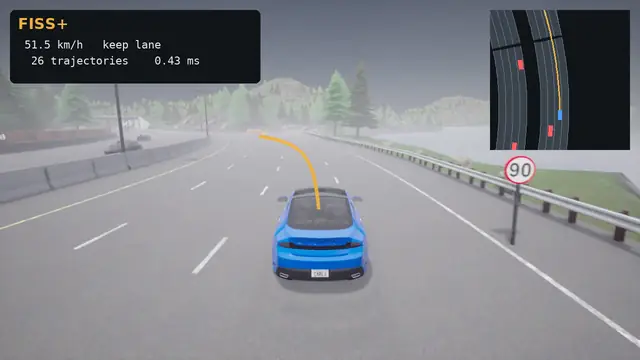
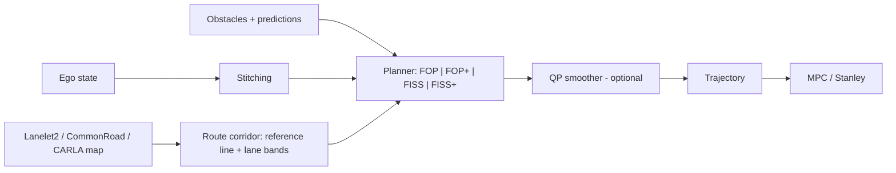

<p align="center">
  
</p>

<p align="center">
  <b>Fast, map-aware trajectory planning for autonomous driving.</b><br/>
  FOP · FISS · FISS+ in one C++17 core, with Python bindings, ROS 2 / ROS 1 nodes and an MPC controller.
</p>

<p align="center">
  <a href="https://github.com/SS47816/frenet_planner/actions/workflows/core.yml"></a>
  <a href="https://github.com/SS47816/frenet_planner/actions/workflows/python.yml"></a>
  <a href="https://github.com/SS47816/frenet_planner/actions/workflows/ros.yml"></a>
  <a href="https://pypi.org/project/frenet-planner/"></a>
  
  
  <a href="LICENSE"></a>
</p>

<p align="center">
  <br/>
  <sub>CARLA 0.9.16: a car cuts in; FISS+ brakes, then steers around it. Amber: executed plan · teal: candidate trajectories · inset: planner view.</sub>
</p>

<p align="center">
  <a href="https://ss47816.github.io/frenet_planner/demo/"><b>▶ Try the interactive replay in your browser</b></a> ·
  <a href="https://ss47816.github.io/frenet_planner/">Documentation</a> ·
  <a href="examples/quickstart.ipynb">Notebook</a><br/><br/>
  <a href="https://colab.research.google.com/github/SS47816/frenet_planner/blob/main/examples/quickstart.ipynb"></a>
</p>

## Why frenet_planner

- **Sub-millisecond planning.** FISS and FISS+ find near-optimal trajectories while generating 5–12× fewer candidates than exhaustive search. A full planning cycle takes **0.2–1 ms**.
- **Four planners, one interface.** Switch between `fop`, `fop_plus`, `fiss` and `fiss_plus` with one parameter, even while the vehicle is driving.
- **Map-aware.** Supports Lanelet2, CommonRoad and CARLA maps. The planner:
  - plans real lane changes using each neighbouring lane's own geometry;
  - only changes lanes where that's legal;
  - caps speed by the speed limit and road curvature;
  - adds a growing cost as the end of the route's lane approaches;
  - stops at red lights.
- **Safe by construction.**
  - Every trajectory is checked against vehicle limits, road edges and time-stamped obstacle predictions.
  - Plans stay consistent between cycles through trajectory stitching.
  - When nothing is safe, the planner falls back to its previous plan or brakes.
- **From planning to control.**
  - An optional QP smoother refines the chosen trajectory inside a space–time driving corridor.
  - An LTV-MPC tracks it with about 1.5 cm lateral error in CARLA.
- **Runs everywhere.** `pip install frenet-planner`, ROS 2 components, a ROS 1 node, or plain CMake.

## Gallery

<table>
  <tr>
    <td colspan="2" align="center"><br/>
    <sub><b>Same merge, three planners.</b> FOP evaluates every candidate (125 per cycle); FISS and FISS+ reach the same decision exploring far fewer.</sub></td>
  </tr>
  <tr>
    <td width="50%"><br/><sub>Dense traffic, US-101 (NGSIM recording)</sub></td>
    <td width="50%"><br/><sub>Left turn at a T-junction</sub></td>
  </tr>
  <tr>
    <td><br/><sub>Zipper merge</sub></td>
    <td><br/><sub>Urban arterial, Lankershim Blvd (NGSIM)</sub></td>
  </tr>
  <tr>
    <td><br/><sub>CARLA: overtaking a parked car</sub></td>
    <td><br/><sub>CARLA: 49 vehicles of mixed traffic</sub></td>
  </tr>
</table>

## Quick start

```bash
pip install frenet-planner
```

```python
import numpy as np
import frenet_planner as fp

x = np.arange(0.0, 300.0, 5.0)
road = fp.ReferenceLine(x, np.zeros_like(x))                     # any polyline
lanes = fp.Corridor.parallel_lanes(0.0, road.length, 3.5, 1, 0)  # ego lane + one lane to the left
parked = fp.predict_constant_velocity(1, 45.0, 0.0, 0.0, 0.0, 4.5, 1.9, horizon=6.0, dt=0.1)

planner = fp.make_planner(fp.make_config("fiss_plus"))
result = planner.plan(fp.FrenetState(s=10.0, s_d=10.0), road, lanes, [parked], target_speed=12.0)
print(result.success, result.trajectory.lane)  # True 1  -> overtakes in the left lane, in < 1 ms
```

`fp.LocalPlanner` wraps the whole pipeline (map, stitching, speed policy, smoothing, fail-safes): call `step(t, ego, obstacles)` every cycle. See the [notebook](examples/quickstart.ipynb) and the [Python guide](docs/python.md).

**ROS 2**

```bash
ros2 launch frenet_planner_ros2 planner.launch.py odom:=/localization/odom \
    obstacles:=/perception/obstacles lanelet2_map:=/maps/town.osm controller:=true
ros2 param set /frenet_planner planner.type fiss      # switch planners live
```

The planner node publishes `~/trajectory` (time-parameterized x, y, yaw, v, a, κ), `~/path`, `~/candidates` and `~/stats`. The controller node publishes `ackermann_msgs/AckermannDriveStamped`. ROS 1 Noetic has the same interface (`roslaunch frenet_planner_ros1 planner.launch`). See [docs/ros.md](docs/ros.md).

## Planners

| | How it searches | Paper |
|---|---|---|
| `fop` | generates every candidate, keeps the cheapest valid one | Werling et al., ICRA 2010 |
| `fop_plus` | generates every candidate, validates lazily in cost order | |
| `fiss` | iterative search over the end-state grid, guided by the previous solution | [Sun et al., RA-L 2022](https://doi.org/10.1109/LRA.2022.3191940) |
| `fiss_plus` | best-first exploration plus continuous end-state refinement | [Sun et al., IROS 2023](https://doi.org/10.1109/IROS55552.2023.10341498) |

All four share sampling, costs and validation, so they are directly comparable and interchangeable.

## Results

**CommonRoad, closed loop.** 280 public scenarios: all 130 NGSIM recordings plus 150 hand-crafted ones. Success uses the official CommonRoad goal check (place, time window, speed and heading) with no collision and no road-boundary violation. The QP smoother is on.

| Planner | Success | Collision | Plan time (mean) | Trajectories per cycle |
|---|---:|---:|---:|---:|
| `fop` | 70.4 % | 2.1 % | 10.5 ms | 205 |
| `fop_plus` | 70.4 % | 2.1 % | 1.1 ms | 205 generated · 11 validated |
| `fiss` | 70.4 % | **1.4 %** | **0.5 ms** | **16** |
| `fiss_plus` | 70.4 % | 2.1 % | 0.8 ms | 41 |

**CARLA 0.9.16, closed loop.**
- **Runs:** 49 runs, all collision-free: lead vehicle, parked car, cut-in and dense traffic, with both controllers.
- **Planning time:** 0.2–1 ms (FISS/FISS+).
- **Tracking:** MPC lateral error 1.3–1.5 cm RMS.

**ROS 2 bag replay.** 20 NGSIM recordings were replayed through the ROS 2 node. Plans stay within 1.3 m of the human driver's path over 3 s on average, at 1.7–2.3 ms per cycle.

Full tables, protocols and ablations are in [docs/benchmarks.md](docs/benchmarks.md); raw results are in [`benchmarks/results/`](benchmarks/results).

## Integrations

| | |
|---|---|
| **Python** | `pip install frenet-planner` (Linux, macOS; Python 3.10–3.13) |
| **ROS 2** | `frenet_planner_ros2`: Jazzy, Humble; component nodes, live parameters |
| **ROS 1** | `frenet_planner_ros1`: Noetic; `dynamic_reconfigure` |
| **Maps** | Lanelet2 (C++ adapter with routing), CommonRoad, CARLA |
| **Simulation** | CommonRoad closed-loop benchmark, CARLA closed loop and video recorder, ROS 2 bag tools |
| **C++** | `find_package(frenet_planner)`; only yaml-cpp, plus OSQP for the optional smoother/MPC |

<details>
<summary><b>Build from source / run the tests</b></summary>

```bash
git clone https://github.com/SS47816/frenet_planner.git && cd frenet_planner
# with pixi (no root needed; ROS from RoboStack)
pixi run test                    # C++ core (GoogleTest)
pixi run -e bench py-test        # Python bindings
pixi run -e jazzy ros2-test      # ROS 2 packages
pixi run -e noetic ros1-test     # ROS 1 packages
# or into a ROS 2 workspace
colcon build --base-paths frenet_planner/{core,msgs,ros/ros2}
```
</details>

<details>
<summary><b>Reproduce the benchmarks and demos</b></summary>

```bash
python benchmarks/commonroad/fetch_scenarios.py --out data/cache/scenarios --bench-set data/cache/bench_set
pixi run -e bench python -m frenet_planner.commonroad.benchmark --scenarios data/cache/bench_set --smoother
pixi run -e bench python -m frenet_planner.commonroad.demo data/cache/bench_set/ZAM_Zip-1_50_T-1.xml \
    --panels fop fiss fiss_plus --gif compare.gif
# CARLA (start $CARLA_ROOT/CarlaUE4.sh -RenderOffScreen first)
pixi run -e carla python -m frenet_planner.carla.closed_loop --planner fop fiss fiss_plus
pixi run -e carla python -m frenet_planner.carla.record --scenario cut_in --mp4 cut_in.mp4
```
</details>

## How it works



End states are sampled over lateral offset (per lane) × target speed × horizon. Lateral motion is a quintic polynomial and longitudinal motion a quartic; both are converted to Cartesian space analytically. The planners differ only in how they search this grid. See [docs/concepts.md](docs/concepts.md).

## Citation

If this project helps your research, please cite:

```bibtex
@article{sun2022fiss,
  author  = {Sun, Shuo and Liu, Zhiyang and Yin, Huan and Ang, Marcelo H.},
  title   = {{FISS}: A Trajectory Planning Framework Using Fast Iterative Search and Sampling Strategy for Autonomous Driving},
  journal = {IEEE Robotics and Automation Letters},
  volume  = {7}, number = {4}, pages = {9985--9992}, year = {2022},
  doi     = {10.1109/LRA.2022.3191940}
}
@inproceedings{sun2023fissplus,
  author    = {Sun, Shuo and Chen, Jie and Sun, Jiawei and Yuan, Chengran and Li, Yuanchen and Zhang, Tangyike and Ang, Marcelo H.},
  title     = {{FISS+}: Efficient and Focused Trajectory Generation and Refinement Using Fast Iterative Search and Sampling Strategy},
  booktitle = {IEEE/RSJ International Conference on Intelligent Robots and Systems (IROS)},
  pages     = {10527--10534}, year = {2023},
  doi       = {10.1109/IROS55552.2023.10341498}
}
```

## Contributing

Issues, discussions and pull requests are welcome; see [CONTRIBUTING.md](CONTRIBUTING.md). Upgrading from the 2021 ROS 1 node? See [docs/migration.md](docs/migration.md).

Licensed under [Apache-2.0](LICENSE).
