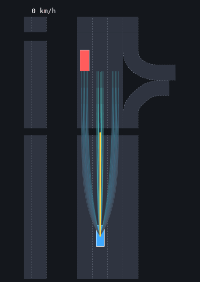

# Benchmarks

All numbers were measured on one machine: an Intel Core i9-12900K (24 threads) with an RTX 3090 Ti
for CARLA, running Ubuntu 24.04. Each planning cycle runs on a single core.
Raw per-run results are in [`benchmarks/results/`](https://github.com/SS47816/fiss_planner/tree/main/benchmarks/results).

## Profiles, splits and tuning

Each benchmark runs with its own planner profile (`python/fiss_planner/profiles/`, chosen with
`--profile`), and every result records the profile and a hash of the resolved settings. A profile is
tuned only on its benchmark's development split and checked on a second held-out split. The test
split is run once per release.

| Benchmark | Profile | Tuning split | Check split | Test split |
|---|---|---|---|---|
| CommonRoad | `commonroad` | `benchmarks/commonroad/dev_set.txt` (100 hand-crafted) | `check_set.txt` (103 hand-crafted) | `bench_set.txt` (280) |
| CARLA scenarios | `carla_scenarios` | – | – | lead vehicle, parked car, cut-in; traffic seeds 0–9 |

The CommonRoad splits are disjoint, and the benchmark reads them directly
(`--scenarios benchmarks/commonroad/dev_set.txt`). Tuning uses Optuna (TPE) over a search space
declared per benchmark in `benchmarks/tuning/`, and the first trial is the current profile:

```bash
python benchmarks/tune.py benchmarks/tuning/commonroad.yaml --trials 60 --jobs 16 --out results/tune/commonroad
```

The tuner writes three things: the best settings as a complete profile with their provenance, a
table of all trials, and the scores of the current and the best profile on the check split. It
refuses test splits.

## CommonRoad, closed loop

**Scenarios.** The set is 280 public scenarios from
[commonroad-scenarios](https://gitlab.lrz.de/tum-cps/commonroad-scenarios) (commit `2416dc2`): all 130 NGSIM
recordings (US-101, Lankershim, Peachtree) and 150 hand-crafted scenarios drawn with seed 0 (list in
`benchmarks/commonroad/bench_set.txt`).

**Protocol.**
- At every 0.1 s step the planner receives the ego state and all obstacles, then the ego moves to its planned state one step later (perfect tracking, as in the FISS / FISS+ papers).
- Traffic is the recorded, non-reactive log.
- Obstacle predictions are ground truth unless stated otherwise.
- The vehicle is CommonRoad's VW Vanagon, and the grid is 5×5×5 per lane.
- The route comes from CommonRoad's route planner. The planner's goal point, where the route's lane changes must be done, is the point of the goal region the ego would pass in the middle of the time window at its initial speed, kept one second of driving inside the region's ends. The target speed brings the ego there in time, given that the planner reaches a new speed within its mean horizon, and stays within the goal speed interval.

**Metrics.**
- *Success*: the official `GoalRegion.is_reached` check, covering position, time window, speed and heading, with no collision and no road-boundary violation (CommonRoad drivability checker).
- *Headway < 1 s*: time per scenario spent less than 1 s behind the vehicle ahead in the ego's path, while keeping the lane (overtaking pull-outs excluded).
- *Min TTC < 2 s*: share of scenarios whose minimum time to collision with that vehicle drops below 2 s.
- *Within 0.5 m*: share of scenarios in which the ego's footprint comes within 0.5 m of another road user's at the same instant.

Weights and thresholds of the distance keeping were fixed a priori (1.5 s desired headway, 4 s desired
TTC, 2 m / 1.5 s hard floor) and checked on a separate development set of 100 hand-crafted scenarios
that are not part of the benchmark; they were not tuned on these 280. The time gap to crossing
traffic (0.75 s) was chosen on the development set as well. The route urgency (a 10 s ramp per lane
change), the reference smoothing (20 m, 0.1 m) and the goal point were set a priori and checked on the
development set and on 103 further hand-crafted scenarios outside the benchmark (zipper merges, highway
and urban scenes, T-junctions). The two sets are listed in `benchmarks/commonroad/dev_set.txt` and
`check_set.txt`.

### Main results

| Planner | Success | Collision | Timeout | Plan time mean / p95 | Generated / validated | Headway < 1 s | Min TTC < 2 s | Within 0.5 m |
|---|---:|---:|---:|---:|---:|---:|---:|---:|
| fop | 66.4 % | 2.1 % | 26.8 % | 9.24 / 13.96 ms | 209 / 209 | 0.15 s | 17.5 % | 6.4 % |
| fop_plus | 66.4 % | 2.1 % | 26.8 % | 1.27 / 2.21 ms | 209 / 15 | 0.15 s | 17.5 % | 6.4 % |
| fiss | 65.4 % | 1.8 % | 28.2 % | 0.66 / 1.39 ms | 19 / 13 | 0.17 s | 16.4 % | 5.4 % |
| fiss_plus | 65.7 % | 2.1 % | 27.9 % | 0.92 / 1.92 ms | 44 / 17 | 0.16 s | 14.3 % | 7.1 % |
| fop + QP | 76.1 % | 2.1 % | 16.8 % | 9.11 / 13.48 ms | 210 / 210 | 0.13 s | 15.4 % | 7.5 % |
| fop_plus + QP | 76.1 % | 2.1 % | 16.8 % | 1.16 / 2.04 ms | 210 / 14 | 0.13 s | 15.4 % | 7.5 % |
| fiss + QP | 75.7 % | 1.8 % | 17.9 % | 0.65 / 1.35 ms | 19 / 13 | 0.13 s | 15.4 % | 6.8 % |
| fiss_plus + QP | 74.6 % | 2.1 % | 18.2 % | 0.86 / 1.73 ms | 44 / 17 | 0.14 s | 12.1 % | 7.9 % |

The four search strategies reach practically the same solutions. FISS generates about 11× fewer
trajectories than FOP and plans about 14× faster. The QP smoother adds 9–10 points of success,
mostly by converting timeouts.

Most of the remaining failures are timeouts in the NGSIM recordings, whose goals combine a place, a
time window of 0.1–1 s and a speed interval in dense traffic. All collisions of FISS+ with the QP
smoother except the two short urban scenarios (`ZAM_Urban-4/5_1_S-1`, within 1.2 s of the start) are
recorded vehicles running into the ego from behind: three times while it waits at a red light, once
after it brakes with a faster vehicle closing in behind. Replayed traffic cannot react to the ego.

### Ablations (fiss_plus with the QP smoother)

| Variant | Success | Collision | Timeout | Headway < 1 s | Min TTC < 2 s | Within 0.5 m |
|---|---:|---:|---:|---:|---:|---:|
| default: ego and adjacent lanes, ground-truth prediction | 74.6 % | 2.1 % | 18.2 % | 0.14 s | 12.1 % | 7.9 % |
| without the safety envelope and proximity cost | 80.4 % | 2.1 % | 12.9 % | 0.47 s | 22.5 % | 20.7 % |
| ego lane only (as in the papers) | 67.1 % | 3.9 % | 24.3 % | 0.23 s | 17.5 % | 8.6 % |
| lane-following prediction | 70.7 % | 8.6 % | 13.6 % | 0.13 s | 1.1 % | 10.0 % |
| constant-velocity prediction | 69.3 % | 10.0 % | 14.6 % | 0.12 s | 1.4 % | 9.3 % |

- **Keeping distance** cuts the time spent below 1 s of headway to under a third, the share of runs
  that get within 2 s TTC of the vehicle ahead almost by half, and the share that come within 0.5 m
  of another road user by more than half, at the same collision rate. In the replayed logs it costs
  5.8 points of success: 18 runs in dense NGSIM traffic time out because the gaps their lane changes
  need before the goal window closes are refused, and recorded traffic does not open them.
- **Route lane changes.** The planner counts the lane changes the route still needs and makes them in
  time for the goal: several changes start earlier than one, and a slower target lane does not hold
  them back once they are due (see [route urgency](concepts.md#corridor-and-lanes)).
- **Turning across traffic.** The time gap to crossing and oncoming vehicles is part of the safety
  envelope. On the development set it brings the runs within 0.5 m of another vehicle from 30 to 0
  (of 100) at the same success rate. In the T-junction of the gallery (`ZAM_Tjunction-1_101`) the
  closest approach during the left turn grows from 0.3 m to 1.0 m, and the time gap from 0.2 s to
  1.0 s. Larger gaps backfire in replayed logs, where traffic does not yield: the ego starts to give
  way and then stops in the vehicle's path. At 1 s one development scenario ends in a collision, at
  1.5 s five do.
- **Map-aware lane sampling** (adjacent lanes) avoids conflicts the ego lane alone cannot.
- **Prediction.** With predictions from the current state only, as a deployed system has them,
  lane-following prediction gains 1.4 points of success over constant-velocity prediction, with
  8.6 % instead of 10.0 % collisions. Recorded traffic still does not react to the ego, so the remaining
  gap to ground-truth predictions is largely the replay itself. TTC values are measured from each
  cycle's predictions, so they are comparable within a prediction mode only.

## ROS 2 bag replay (open loop)

`fiss_planner.bags.from_commonroad` turns NGSIM recordings into MCAP bags. A logged vehicle is the
ego (`/odom`), its lane chain is the reference (`/planning/reference_path`), and all other traffic is
published with constant-velocity predictions (`/perception/obstacles`). `bag_replay_eval.py` plays
each bag through the real ROS 2 node (`plan_on_odom`, sim time) and compares every plan with where
the logged driver went.

| Planner | Cycles with a plan | Emergency stops | ADE 3 s | FDE 3 s | Node cycle mean / p95 |
|---|---:|---:|---:|---:|---:|
| fop | 84.0 % | 3.8 % | 1.45 m | 4.02 m | 10.9 / 17.1 ms |
| fop_plus | 83.6 % | 3.7 % | 1.37 m | 3.96 m | 3.2 / 6.7 ms |
| fiss | 83.3 % | 3.6 % | 1.33 m | 4.33 m | 2.6 / 7.3 ms |
| fiss_plus | 83.2 % | 3.2 % | 1.29 m | 4.21 m | 2.4 / 5.7 ms |

The replay is open loop: the ego follows the log, not the plan. A missing plan therefore mostly
means the logged driver's situation, for example a gap closing under constant-velocity prediction,
violates the planner's margins.

## CARLA

CARLA 0.9.16 runs headless and synchronously (20 Hz physics) on Town04. Every 0.1 s the planner gets
the ego state, the CARLA map as a `RoadMap`, with lane-change rules from the road markings and the route
from CARLA's `GlobalRoutePlanner`, and all actors with lane-following predictions on that map. CARLA
traffic reacts to the ego, so followers in its own lane are left to keep their distance
(`ignore_rear_in_lane`). The controller tracks the plan at 20 Hz. Collisions and lane invasions come
from CARLA sensors; time headway and time to collision are measured to the vehicle ahead in the ego's
path every planning cycle.

Scenarios:
- *lead vehicle*: a slower car ahead.
- *parked car*: a stopped car in the ego lane.
- *cut-in*: a scripted car drives at 9 m/s in the adjacent lane, then merges into the ego lane 8–20 m ahead within 2.5 s.
- *traffic*: 49 Traffic Manager vehicles, 60 s along a cross-map route.

| Chase camera | Bird's-eye (planner view) |
|---|---|
|  |  |

Full-length videos (cut-in, parked car, traffic) are attached to the GitHub release; regenerate them with
`python -m fiss_planner.carla.record --scenario <name> --mp4 <file>`.

### Planners (MPC controller, Town04)

| Scenario | Planner | Collisions | Plan success | Emergency | Min TTC | Min headway | Min clearance | Mean speed | Plan time |
|---|---|---:|---:|---:|---:|---:|---:|---:|---:|
| lead vehicle | fop | 0 | 100.0 % | 0.0 % | 3.7 s | 1.8 s | 1.9 m | 12.2 m/s | 4.95 ms |
| lead vehicle | fop_plus | 0 | 100.0 % | 0.0 % | 11.3 s | 11.3 s | 1.3 m | 12.2 m/s | 0.53 ms |
| lead vehicle | fiss | 0 | 100.0 % | 0.0 % | 4.5 s | 1.9 s | 1.3 m | 11.3 m/s | 0.19 ms |
| lead vehicle | fiss_plus | 0 | 100.0 % | 0.0 % | 3.7 s | 1.8 s | 1.9 m | 12.2 m/s | 0.28 ms |
| parked car | fop | 0 | 100.0 % | 0.0 % | 7.6 s | 7.6 s | 1.2 m | 12.2 m/s | 4.35 ms |
| parked car | fop_plus | 0 | 100.0 % | 0.0 % | 7.6 s | 7.6 s | 1.2 m | 12.2 m/s | 0.55 ms |
| parked car | fiss | 0 | 100.0 % | 0.0 % | 7.6 s | 7.6 s | 1.2 m | 12.2 m/s | 0.14 ms |
| parked car | fiss_plus | 0 | 100.0 % | 0.0 % | 4.9 s | 4.9 s | 1.8 m | 12.4 m/s | 0.29 ms |
| cut-in (scripted) | fop | 0 | 98.3 % | 1.3 % | 1.3 s | 0.1 s | 0.5 m | 10.5 m/s | 5.79 ms |
| cut-in (scripted) | fop_plus | 0 | 99.0 % | 0.7 % | 1.2 s | 0.3 s | 0.7 m | 10.9 m/s | 0.77 ms |
| cut-in (scripted) | fiss | 0 | 99.0 % | 0.7 % | 1.1 s | 0.2 s | 0.7 m | 10.8 m/s | 0.34 ms |
| cut-in (scripted) | fiss_plus | 0 | 98.3 % | 0.3 % | 1.3 s | 0.5 s | 0.7 m | 11.2 m/s | 0.39 ms |
| traffic (49 TM vehicles, 60 s) | fop | 0 | 100.0 % | 0.0 % | 7.2 s | 3.8 s | 1.8 m | 13.3 m/s | 4.75 ms |
| traffic (49 TM vehicles, 60 s) | fop_plus | 0 | 100.0 % | 0.0 % | 4.6 s | 2.2 s | 1.6 m | 13.3 m/s | 0.55 ms |
| traffic (49 TM vehicles, 60 s) | fiss | 0 | 100.0 % | 0.0 % | 4.5 s | 2.1 s | 1.5 m | 13.4 m/s | 0.20 ms |
| traffic (49 TM vehicles, 60 s) | fiss_plus | 0 | 100.0 % | 0.0 % | 2.0 s | 0.9 s | 1.4 m | 13.3 m/s | 0.33 ms |

The Stanley+PID runs are in the JSON file; they give the same picture. Minimum TTC and headway are
measured to the vehicle ahead while keeping the lane. The scripted cut-in merges 8–20 m ahead within
2.5 s, closing at several metres per second: every planner brakes (the emergency cycles), then follows
or moves over a lane, without a collision. It is the tightest scenario. When the car merges, no plan
can keep the safety envelope; the retry that keeps it as a cost then brakes firmly towards the
car's speed, and the closest approach (box to box) is 0.5–0.8 m over all planners and both
controllers. Varying the reference line by a few centimetres keeps the FISS+ result between 0.6 m
and 0.9 m.

### Dense traffic, ten seeds (FISS+, MPC)

Traffic Manager behaviour differs from run to run, so configurations are compared over ten seeds of the
60 s traffic scenario rather than single runs. The second row switches off map-aware prediction,
distance keeping, the rear-vehicle rule and the fallback retries.

| Configuration | Runs | Collisions | Plan success | Emergency | Fallback | Headway < 1 s | Median min TTC | Distance | Plan time |
|---|---:|---:|---:|---:|---:|---:|---:|---:|---:|
| default | 10 | 0 | 99.5 % | 0.00 % | 0.50 % | 0.00 s | 4.03 s | 666 m | 0.42 ms |
| constant-velocity prediction, no distance keeping, no rear rule, no retries | 10 | 0 | 99.8 % | 0.05 % | 0.20 % | 4.66 s | 4.07 s | 672 m | 0.54 ms |

Both configurations plan almost every cycle. Without distance keeping the ego spends 4.7 s per run
less than 1 s behind the vehicle ahead, with the defaults none, and its predictions of vehicles in
the next lane sweep across its own lane instead of following theirs. The routes cross the town, and
the ego takes their turns at junctions.

Two runs end in a jam: in seed 7 the ego queues behind a stopped car, in seed 9 it waits at a junction
for traffic crossing its path. It comes to rest about 3.5 m behind the stopped car (the desired gap
is 3 m) and plans 98.7 % and 97.5 % of the cycles of these runs; the other eight plan 99.9 %, with no
emergency braking.

### Controllers (FISS+ planner)

| Scenario | Controller | Collisions | Lateral error RMS | Along-track lag RMS |
|---|---|---:|---:|---:|
| cruise | mpc | 0 | 1.4 cm | 1.04 m |
| cruise | stanley_pid | 0 | 12.4 cm | 0.85 m |
| parked car | mpc | 0 | 1.5 cm | 1.05 m |
| parked car | stanley_pid | 0 | 12.6 cm | 0.85 m |
| cut-in (scripted) | mpc | 0 | 0.8 cm | 0.87 m |
| cut-in (scripted) | stanley_pid | 0 | 6.5 cm | 0.70 m |
| traffic (30 s) | mpc | 0 | 1.1 cm | 1.01 m |
| traffic (30 s) | stanley_pid | 0 | 8.5 cm | 0.98 m |

Lane invasions are not shown in the tables because evasive lane changes and overtakes trigger them by design. They are
included in the JSON files. The along-track lag is mostly the 0.05 s latency compensation in the
stitching plus the simple throttle/brake mapping of the runner (`Actuation`); lateral tracking is the
controller's job, and the MPC holds it to 1–2 cm.

